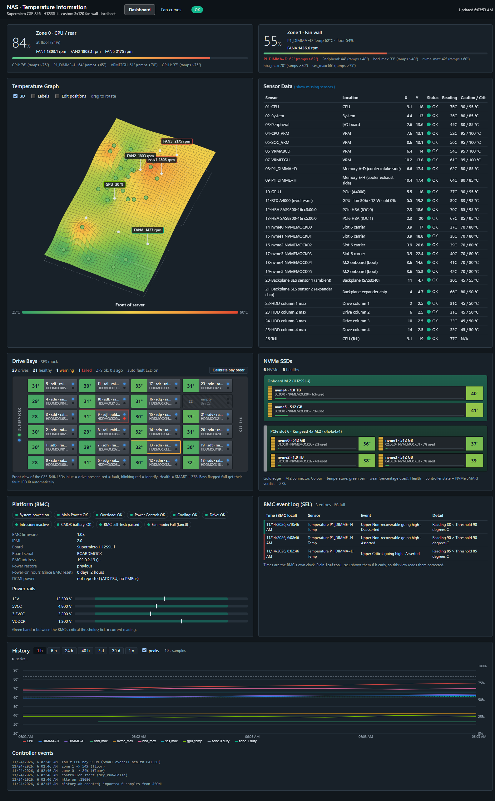
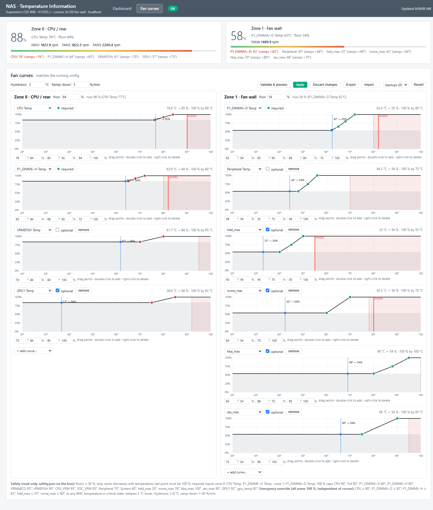

# fan-service

**A zoned fan controller and iLO-style thermal dashboard for Supermicro servers running TrueNAS SCALE.**

Because your RAM shouldn't hit 90 °C at 3 AM just because Plex decided to generate loudness data.



fan-service drives the BMC fan zones of a Supermicro board from temperature curves, and shows you everything it
sees: an interpolated heat map of the chassis, the drive bays as they physically sit on the backplane, NVMe, HBA and
GPU temperatures, BMC health and event log, and a long-term history. It's a single Python file with no dependencies
beyond the standard library, plus one HTML page.

## Features

**Fan control**
- Each BMC zone runs at the **maximum demand of its curves** (piecewise-linear, any number of inputs): it ramps up
  immediately and comes down slowly (rate-limited, with hysteresis). It never drops below the zone floor.
- Inputs: any BMC temperature, CPU Tctl, NVMe, HDD max (SMART, never wakes sleeping disks), LSI HBA chip
  temperature (mpt3sas ioctl), SES backplane sensors, GPU (nvidia-smi).
- **Safety layer you can only change from a shell** (`safety.json`): minimum floors, required inputs per zone, "must reach
  100 % by X °C" caps, and an **emergency override** (any sensor over its limit sends all zones to 100 %, released per
  sensor). Every config change is validated against it: from the UI, an import, a revert or a hand edit.
- **Failsafe:** a missing required sensor, repeated read failures or a crash sends all zones to 100 %. Duty writes are
  checked and read back from the BMC.
- **Host watchdog** (cron): if the controller stops sending heartbeats, the host forces the fans to 100 %. If the app
  is deliberately stopped and it gets hot, a thermal guard still kicks in.
- **Email notifications** through TrueNAS's own mail settings. No API key lives in the container.

**Dashboard**
- iLO-style **heat map** (2D or rotatable 3D) of sensor positions over a top-down chassis plan; drag sensors to place them.
- **Drive bays** laid out like the real chassis front, with bay order from the SES backplane. Shows temperature,
  SMART and ZFS health, and the identify/fault LEDs. Failed or missing drives get their fault LED lit automatically.
- NVMe cards, HBA, GPU, BMC platform (PSU/fan/intrusion/CMOS battery, voltage rails) and SEL viewer.
- History (SQLite: 10 s raw for 7 days, 1-min for 30 days, 15-min for 2 years) with peak lines.
- **Fan-curve editor:** drag points, validate and preview, apply with an edit token, import/export, backups/revert.
- Follows your system light/dark theme.



## Try it without hardware

```sh
cd fanctl/app
python3 fanctl.py --mock --data ./mockdata --port 18090
# open http://localhost:18090
```

Mock mode generates synthetic sensors, drives and events. All screenshots in this repo come from it.

## Hardware

Developed on a Supermicro CSE-846 (24-bay SAS3 expander backplane) with an H12SSL-i and EPYC, a custom 3×120 mm fan
wall, LSI SAS3008/SAS2116 HBAs and an NVIDIA GPU. Fan control uses the Supermicro OEM IPMI commands
(`raw 0x30 0x45` fan mode, `raw 0x30 0x70 0x66` zone duty), which work on most X10/X11/X12/H11/H12-generation boards:
zone 0 = `FAN1..n`, zone 1 = `FANA..`. Everything else (zones, curves, sensor positions, bay order) is configuration.

The shipped curves and floors are tuned for that reference box. **Retune them for yours.** [docs/FANS.md](docs/FANS.md)
shows how: a scripted stress test that maps every sensor against each zone's duty.

## Install

See [docs/INSTALL.md](docs/INSTALL.md) for TrueNAS SCALE: build the image, create the app, add the watchdog cron
job, then tune. The controller and API reference is in [fanctl/README.md](fanctl/README.md).

## ⚠️ Read this first

This software sends raw IPMI commands to your BMC and decides how fast your fans spin. A bad configuration can let
hardware overheat. It is built to fail loud (100 % fans) rather than fail hot, but it comes with **no warranty**.
Start with `"dry_run": true`, watch the dashboard and check the zone mapping on your own board before you trust it.

## License

[MIT](LICENSE)
